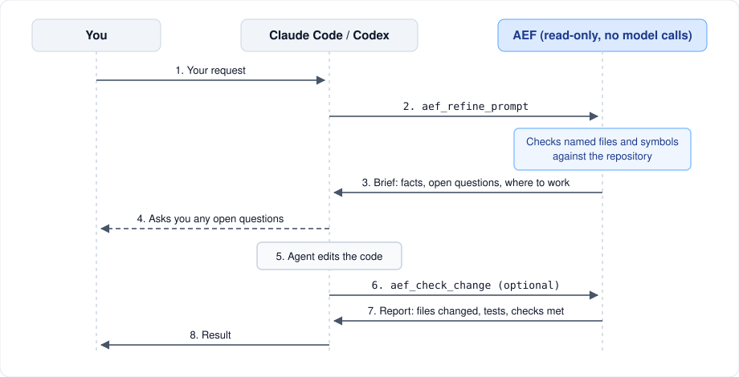

# AEF Platform

AEF is a read-only grounding layer for coding agents such as Claude Code and Codex. Before the agent edits, AEF checks your request against the repository and hands back a short brief of what is true, what is unclear, and where to work. After the agent edits, it reports what actually changed.

It does not replace the agent and it never writes code. The agent stays in charge; AEF only supplies checked facts.

## How it fits in



## What it does

AEF adds two tools to your agent over MCP.

**`aef_refine_prompt`** takes your request and a repository path and returns a brief:

- **Verified facts**: files and symbols you named that exist, each with the file (and line) that proves it.
- **Open questions**: things you named that were not found, or that match several places, with the closest real matches. The agent should ask you these instead of guessing.
- **Where to work**: the files you named, up to five unconfirmed candidate files, and the tests that cover them.
- **Build and test**: the usual command for the detected stack.
- **Done when**: checkable conditions for the change.

**`aef_check_change`** reports on a change the agent has made: files changed, files outside the expected set, affected tests, the build and test result, and each acceptance check as `met`, `not met` or `cannot tell`. A check it cannot evaluate is never assumed met.

Both tools only read. They make no model calls, so AEF has no API bill of its own. A typical brief is about 150 tokens and the tool list about 270 tokens per session.

## Examples

These are real outputs from running AEF on this repository.

### A request that names real code

Request: *"Make BuildSystemDetector return the gradle wrapper on Windows"*

```
## Verified facts
- `BuildSystemDetector` is a class (src/Runtime/DomainContent/RepositoryValidation/BuildSystemDetector.cs:8)

## Where to work
- Work in: src/Runtime/DomainContent/RepositoryValidation/BuildSystemDetector.cs.
- Candidate files (confirm which apply before editing): tests/Runtime.Tests/Integration/DeliveryExecution/ProcessVerificationRunnerTests.cs, src/Runtime/Integration/RepositoryScanning/StackDetector.cs, tests/Runtime.Tests/DomainContent/RepositoryValidation/BuildSystemDetectorTests.cs, ...
- Covering tests: tests/Runtime.Tests/DomainContent/RepositoryValidation/BuildSystemDetectorTests.cs, tests/Runtime.Tests/Integration/RepositoryScanning/StackDetectorTests.cs, ...

## Build and test
- `dotnet test` (conventional for the stack, unverified)

## Done when
- `dotnet test` exits 0
- Changes are confined to the files under Where to work, or each extra file is explained
- Tests in tests/Runtime.Tests/DomainContent/RepositoryValidation/BuildSystemDetectorTests.cs pass
```

The agent starts in the right file with its tests, instead of searching for them.

### A request that names something that does not exist

Request: *"Fix the retry logic in OrderService.Submit"* (there is no `OrderService` in this repository)

```
## Open questions
- The prompt mentions `OrderService.Submit`, which was not found in the repository. Closest matches: `FindSymbol` (tests/Runtime.Tests/Execution/EngineeringExecutionPipelineTests.cs:403), ... Which did you mean?

## Done when
- `dotnet test` exits 0
- Every open question above is answered before editing
```

The agent is told to ask you, rather than invent an `OrderService` or edit something else. The "closest matches" are a text search and can be poor, as here.

### A vague request

Request: *"make it faster"*

```
## Where to work
- Candidate files (confirm which apply before editing): README.md, tests/Runtime.Tests/DomainContent/PromptGrounding/PromptGroundingTests.cs.

## Build and test
- `dotnet test` (conventional for the stack, unverified)
```

With nothing specific named there is nothing to verify, so the brief adds little. This is the case where the call is not worth making.

### Checking a change

After an edit that was meant to touch only `README.md` but also added an image, `aef_check_change` with `ExpectedFiles` set to `README.md`:

```
## Files changed
- docs/images/aef-flow.svg

## Outside the expected files
- docs/images/aef-flow.svg

## Acceptance checks
- [not met] Changes are confined to the files under Where to work, or each extra file is explained - Changed outside the expected set: docs/images/aef-flow.svg. Explain or revert each.
- [cannot tell] `dotnet test` exits 0 - Build and tests were not run.
- [cannot tell] The diagram is easy to read - Not machine-checkable; needs human or agent review.

## Notes
- Compared against merge-base with origin/main (93e401d).
- Build and tests were not run.
```

It flags the file outside the expected set and refuses to guess on checks it cannot evaluate.

### Calling it from the command line

```
aef-cli execute --user-request "refine prompt" --project-profile-id p --payload-json "{\"UserPrompt\":\"add retries to OrderService\",\"RepositoryName\":\"shop\",\"RepositoryRoot\":\"C:/src/shop\"}"
aef-cli execute --user-request "check change" --project-profile-id p --payload-json "{\"RepositoryName\":\"shop\",\"RepositoryRoot\":\"C:/src/shop\",\"SkipBuildAndTests\":\"true\"}"
```

## Does it help?

Not proven. This is the honest state of the evidence:

- **Correctness of what it says:** in a sweep over three real repositories, all 209 file and line citations were valid.
- **Effect on the agent's work:** across nine real tasks on two models (`sonnet` and `haiku`), the agent changed the right files just as often without AEF as with it. Cost was about the same; each task was a little slower.
- **Not yet tested:** vague or mistaken requests (a wrong file name, a symbol that does not exist), which is the case AEF was built for.

Details: [`docs/reliability/AEF-Agent-Grounding-Comparison-2026-11.md`](docs/reliability/AEF-Agent-Grounding-Comparison-2026-11.md) and [`docs/reliability/AEF-v1.0-MCP-Dogfooding-Sweep-2026-11.md`](docs/reliability/AEF-v1.0-MCP-Dogfooding-Sweep-2026-11.md).

## Requirements

- .NET 8 SDK
- `git` on PATH
- the `tokensave` command-line tool on PATH for symbol lookup. Without it a brief is still returned; it checks named files on disk and says code intelligence is unavailable.

## Install

Publish a copy of the MCP server and register it with your agent. Do not register the `bin/Debug` output: a running server locks those files and blocks the next build.

```
dotnet publish src/Mcp -c Release -o <install-dir>
claude mcp add aef-mcp -s user -- dotnet <install-dir>/AefPlatform.Mcp.dll
```

For Codex, add the same command (`dotnet` with the dll path as its argument) as an MCP server in its configuration.

Then index each repository you want to work in, once:

```
cd <your-repository>
tokensave init
```

Republish after pulling new AEF code; the registered server is only as new as the last publish.

### What registration does

`claude mcp add` only records a command. Nothing is installed into Claude Code and nothing runs in the background.

- **Where it is stored.** `-s user` writes the entry to your user configuration, so the server is available in every project. Use `-s project` to write it to a `.mcp.json` file in the repository and share it with your team, or `-s local` to keep it to yourself in one project.
- **What happens at startup.** Each time a Claude Code session starts, it launches `dotnet <install-dir>/AefPlatform.Mcp.dll` as a child process and talks to it over standard input and output. The server stops when the session ends.
- **What the agent sees.** The server answers with its tool list: `aef_refine_prompt` and `aef_check_change`, each with a description and its arguments. Claude Code names them `mcp__aef-mcp__aef_refine_prompt` and `mcp__aef-mcp__aef_check_change`.

Check it with:

```
claude mcp get aef-mcp
```

It should print `Status: ✓ Connected`. Inside a session, `/mcp` shows the same and lets you reconnect or disable the server. To remove it: `claude mcp remove aef-mcp -s user`.

If it shows as failed to connect, the dll path is usually wrong or stale: publish again and check that the path in `claude mcp get aef-mcp` exists. A session that was already open when you republished needs `/mcp` → reconnect.

For Codex, the equivalent is an entry in `~/.codex/config.toml`:

```toml
[mcp_servers.aef-mcp]
command = "dotnet"
args = ["<install-dir>/AefPlatform.Mcp.dll"]
```

### How the agent decides to call it

There is no hook or trigger. The agent reads the tool descriptions and decides for itself, the same way it decides to read a file or run a search. The descriptions are written to steer that choice:

- `aef_refine_prompt`: "Call once before editing when the request names a file, symbol or identifier. ... Skip it when the request names nothing specific."
- `aef_check_change`: "Optional, after editing: lists files changed since a base, files outside ExpectedFiles, and affected tests. ..."

So for "add a timeout to `ExternalProcess.Run`" the agent is expected to call `aef_refine_prompt` first, and for "tidy this up" it is expected not to. It passes your request as `UserPrompt` and the current working directory as `RepositoryRoot`.

Because the choice is the model's, it is not guaranteed. In the measured runs the prompt told the agent to call the tools, so how often an agent calls them unprompted has not been measured. Two things make it reliable:

**Tell the agent in your project instructions.** Add this to the repository's `CLAUDE.md` (or `AGENTS.md` for Codex):

```markdown
Before editing code for a request that names a file, symbol or identifier, call
`aef_refine_prompt` with the request, this repository's name and its root path.
Ask me any open questions it returns before editing.
When the change is finished, call `aef_check_change` with `SkipBuildAndTests` "true".
```

**Allow the tools so there is no permission prompt.** In `.claude/settings.json` (project) or `~/.claude/settings.json` (user):

```json
{
  "permissions": {
    "allow": [
      "mcp__aef-mcp__aef_refine_prompt",
      "mcp__aef-mcp__aef_check_change"
    ]
  }
}
```

Both tools only read, apart from `aef_check_change` running your build and tests when `SkipBuildAndTests` is not `"true"`.

## Use

Work in Claude Code or Codex as usual. The agent sees the two tools and can call them itself; you can also ask for them directly:

- "Call `aef_refine_prompt` on this request before you start: add a retry to `OrderService.Submit`."
- "When you are done, call `aef_check_change`."

It is most useful when your request names specific files or symbols. For a request that names nothing specific, the agent is told to skip the call.

Tips to keep cost down:

- Pass `SkipBuildAndTests` as `"true"` to `aef_check_change` unless you want the test run.
- Disable the server (`/mcp` in Claude Code) in projects where you are not using it.

Full tool reference, arguments and configuration: [`docs/mcp/mcp-adapter-reference.md`](docs/mcp/mcp-adapter-reference.md).

## Other ways to call it

The same capabilities are available without an agent:

- **CLI**: `aef-cli execute --user-request "refine prompt" --project-profile-id p --payload-json "{...}"`. See [`docs/cli/cli-adapter-reference.md`](docs/cli/cli-adapter-reference.md).
- **REST**: `dotnet run --project src/Host`, then `POST /api/v1/execution`. See [`docs/api/rest-adapter-reference.md`](docs/api/rest-adapter-reference.md).

The server also carries thirteen older tools (repository analysis, planning, validation, lifecycle workflows). They are hidden by default and listed when `Mcp__ExposeAllTools=true`. Most are deterministic and return generic findings; three are deferred.

## What it cannot do

- Write, edit or commit code.
- Judge whether a change is correct beyond the build, the tests and file scope.
- Keep anything between runs: sessions and evidence are in memory only.
- Authenticate callers: it is meant for local use over stdio or localhost.

## Build and test

```
dotnet build AefPlatform.sln
dotnet test AefPlatform.sln
```

## Repository layout

- `src/Kernel`, `src/Runtime`: the execution core (registry, hosts, skills, pipeline).
- `src/Runtime/DomainContent/PromptGrounding`, `src/Runtime/DomainContent/ChangeCheck`: the two grounding tools.
- `src/Runtime/Integration/CodeIntelligence`: the `tokensave` backend.
- `src/Runtime.Agent`: the public execution interface every channel uses.
- `src/Mcp`, `src/Cli`, `src/Host`: the MCP server, the CLI and the REST host, with their adapters in `src/Adapters.*`.
- `tools/grounding-comparison`: the script that runs a task with and without AEF and scores both.
- `docs/guides`: developer, operations and deployment guides.

The milestone-by-milestone history that used to be on this page is in [`docs/project-history.md`](docs/project-history.md).
